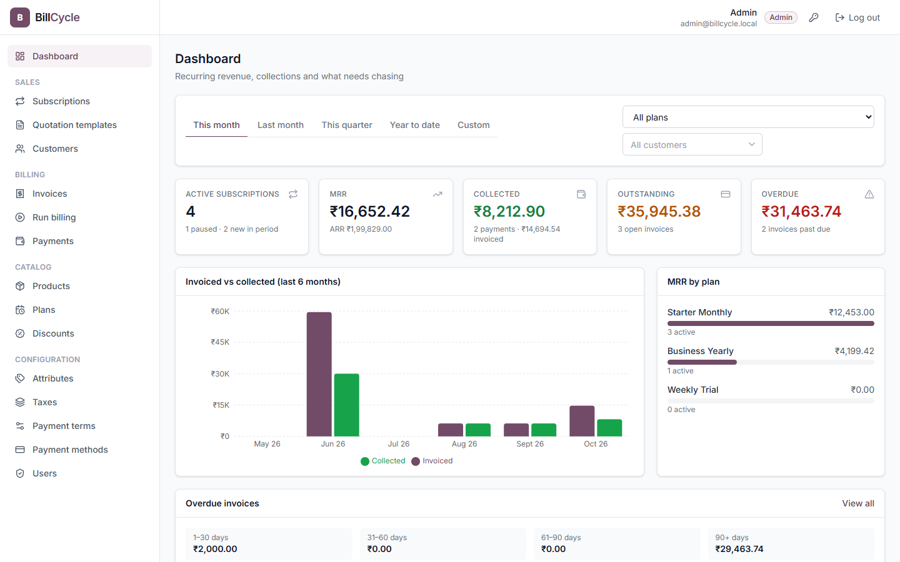
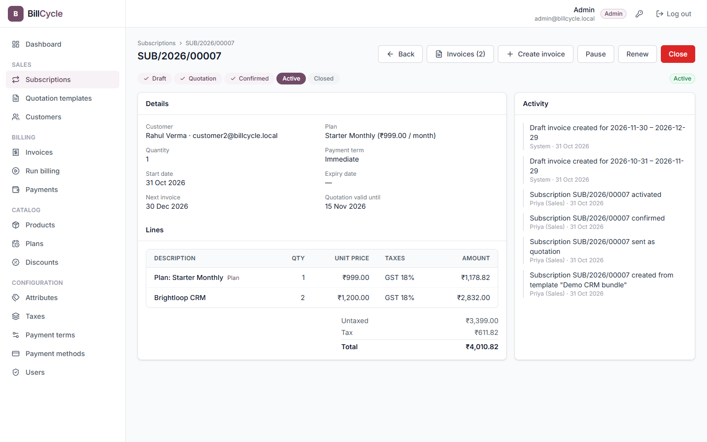

# BillCycle

Subscription management system: products, recurring plans, quotations, subscriptions, automatic invoicing, payments, a revenue dashboard and a customer self-service portal in one place.
Built for the **Odoo x Flux Hackathon** (problem statement: *Subscription Management System* for "Brightloop Software").



## Features

**Sales**
- **Subscriptions** with an Odoo-style lifecycle: Draft → Quotation → Confirmed → Active → Paused / Closed, with each action allowed only from the right state.
- Plan line plus product add-ons, live totals (untaxed, tax, total), `SUB/YYYY/NNNNN` numbering and an activity log of who did what.
- **Quotation templates** that pre-fill a plan and product lines; quotes get a validity date.
- **Customers** with contact and billing details.

**Billing**
- **Invoice generation** per billing period. A database constraint makes billing the same period twice impossible.
- Confirm (assigns `INV/YYYY/NNNNN`), cancel, email to the customer and a **printable invoice**.
- **Billing run**: bills every due subscription up to a date, catches up missed periods, and keeps a history of runs. A nightly scheduler runs it automatically.
- **Payments**: full or partial. Invoice status (Paid, Partially paid, Outstanding, Overdue) is always derived from the payments, never stored by hand.

**Catalog and configuration**
- **Products and variants** with attributes (e.g. Brand: Odoo +₹560); the variant price is computed from the base price plus each attribute's extra.
- **Recurring plans**: daily, weekly, monthly or yearly with an interval, minimum quantity, availability window and pause / renew / close options.
- **Taxes** (GST 18%, 5%…), **payment terms**, **payment methods** and **discount rules** with date windows and usage limits.

**Reporting**
- **Dashboard**: active subscriptions, MRR / ARR, collected, outstanding and overdue amounts, invoiced vs collected over 6 months, MRR by plan and overdue aging, filterable by period, plan and customer.

**Customer portal**
- Customers sign up and see only **their own** subscriptions and invoices, print invoices and manage their profile.

**Security**
- Three roles (Admin, Internal staff, Portal customer), enforced on the server on every route.
- Passwords hashed with bcrypt and a JWT in an httpOnly cookie.
- Strong password rules, rate-limited login, and password reset by emailed single-use link.



## Tech stack

| Layer | Technology |
|---|---|
| Frontend | React 19, Vite, TypeScript, Tailwind CSS v4, React Router, TanStack Query, React Hook Form + Zod, Recharts, lucide-react |
| Backend | Node.js, Express 5, TypeScript (strict), Zod validation, bcrypt, JWT (httpOnly cookie), node-cron, Nodemailer |
| Database | PostgreSQL 16 with Prisma ORM (migrations, seed) |
| Dev tooling | Docker Compose (Postgres + Mailpit for emails), Vitest, ESLint, Prettier |

No backend-as-a-service and no third-party APIs: all data lives in the local PostgreSQL database and is served through our own API.

## Engineering highlights

- **Database design**:
  - normalised schema with 20+ tables
  - money stored as `Decimal(12,2)`; JavaScript floating-point numbers are never used for money
  - `CHECK` constraints on amounts and quantities
  - a partial unique index on `(subscription_id, period_start)` that prevents double billing
  - case-insensitive unique emails
  - transactional numbering sequences
- **Billing correctness**:
  - tax is calculated after discount, with half-up rounding
  - invoice generation is idempotent and safe under concurrency (row locks, one transaction per subscription)
  - payments lock the invoice row before updating the balance
- **Validation on both sides**:
  - Zod schemas on the server are the authority
  - the client shows field-level errors returned by the API
- **Consistent API**:
  - list responses: `{ data, meta: { page, limit, total } }`, always paginated, searchable and sortable on the server
  - errors: `{ error: { code, message, fields } }`
- **Modular code**:
  - one folder per domain on the server, each with routes, controller, service and schema files
  - one folder per feature on the client
  - a shared UI kit
- **Tests**: 110+ Vitest tests covering money and tax math, billing periods, the subscription state machine, invoice generation, the discount engine and plan rules.

## Getting started

Requires Node 20+ and Docker Desktop.

```bash
docker compose up -d                 # PostgreSQL on :5433, Mailpit (emails) UI on http://localhost:8025

cd server
cp .env.example .env
npm install
npx prisma migrate dev               # create tables
npm run seed                         # demo data
npm run dev                          # API on http://localhost:4000/api  (health: /api/health)

cd ../client                         # second terminal
cp .env.example .env
npm install
npm run dev                          # app on http://localhost:5173 (proxies /api to :4000)
```

Fresh database any time: `cd server && npm run db:reset` (drops, migrates, seeds).

| Login | Email | Password |
|---|---|---|
| Admin | admin@billcycle.local | Admin@12345 |
| Staff | staff@billcycle.local | Staff@12345 |
| Customer (portal) | customer1@billcycle.local (also 2, 3) | Customer@123 |

Emails sent by the app (password reset, invoices) appear in Mailpit at http://localhost:8025.

Useful: `npm run typecheck`, `npm run lint`, `npm test` (server and client), `npm run db:studio` (browse the DB).

## Repository layout

```
server/   Express API: modules per domain, Prisma schema + migrations + seed, billing jobs
client/   React app: features per domain, shared UI kit
docs/     Problem analysis, requirements, domain model, business rules, roles, plan, screenshots
```

## Team

| Member | Area |
|---|---|
| Manoj Kharkar | Foundation, database schema, auth and roles, customers, payments, dashboard, customer portal |
| Sandhya Parmar | Catalog (attributes, products, variants), plans, taxes, payment terms and methods, discounts, quotation templates |
| Shubham Kang | Subscriptions and lifecycle, invoice generation and actions, billing run, scheduler |
| Challa Trivedh Kumar | Billing-period engine, printable invoice |

## Docs

Start at [docs/README.md](docs/README.md): problem statement, requirements, [domain model](docs/03-domain-model.md), [business rules](docs/04-business-rules.md) and [roles](docs/05-roles-permissions.md). Contribution rules are in [AGENTS.md](AGENTS.md).
